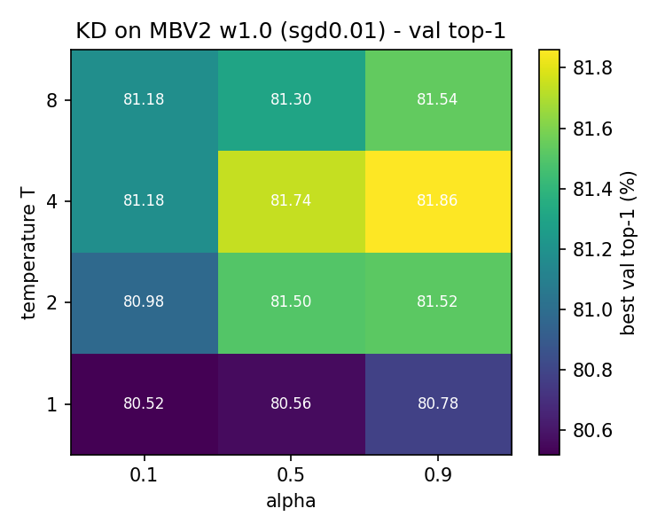
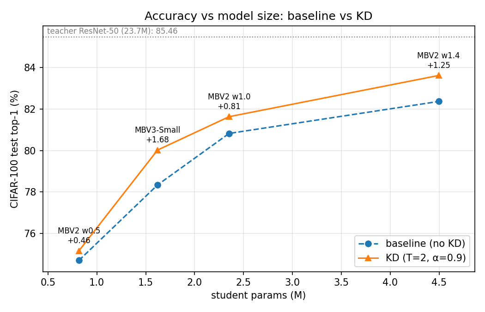
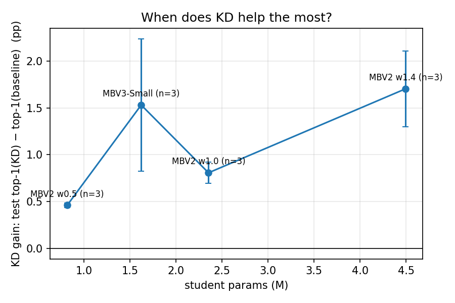
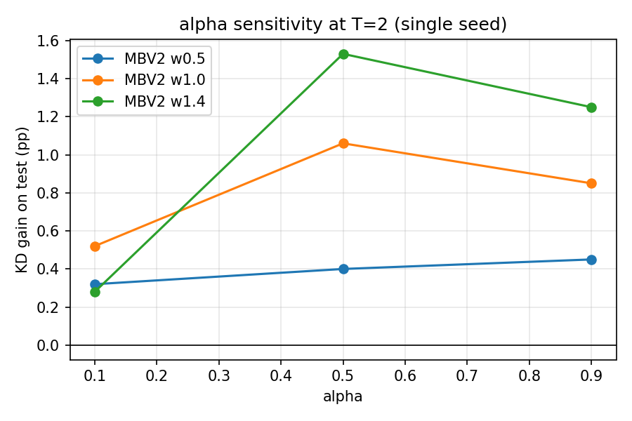
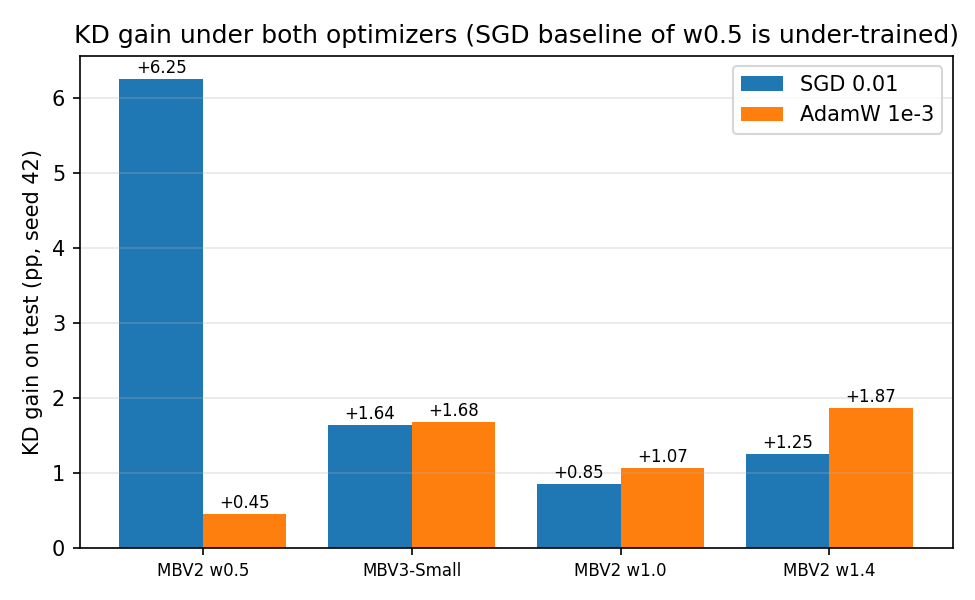
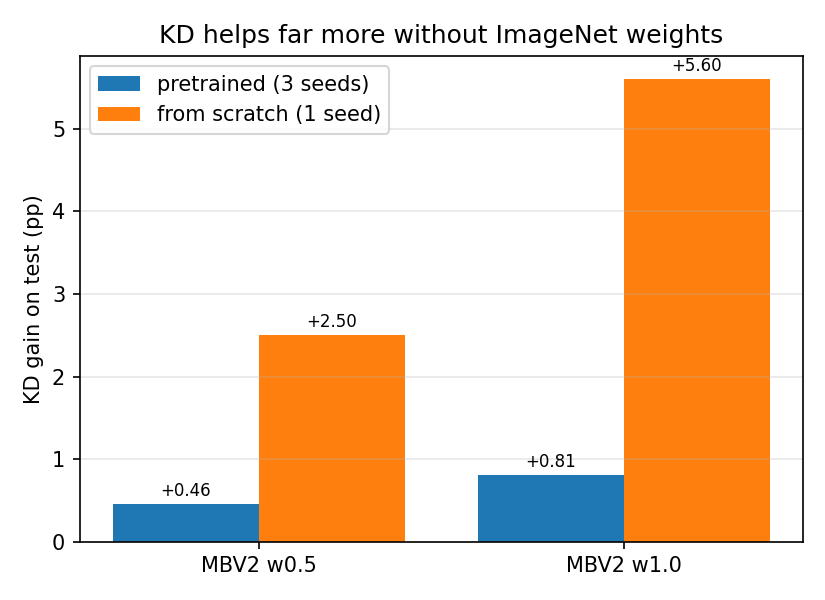
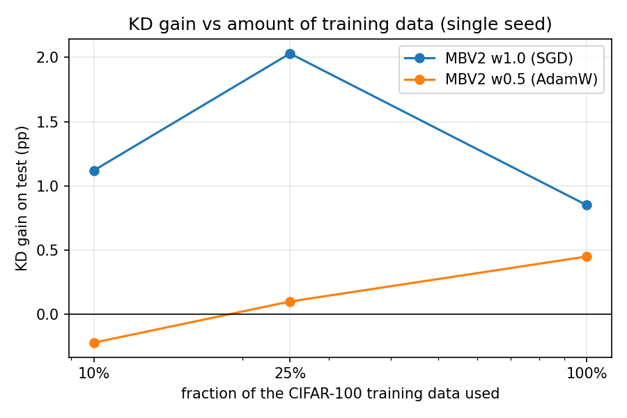
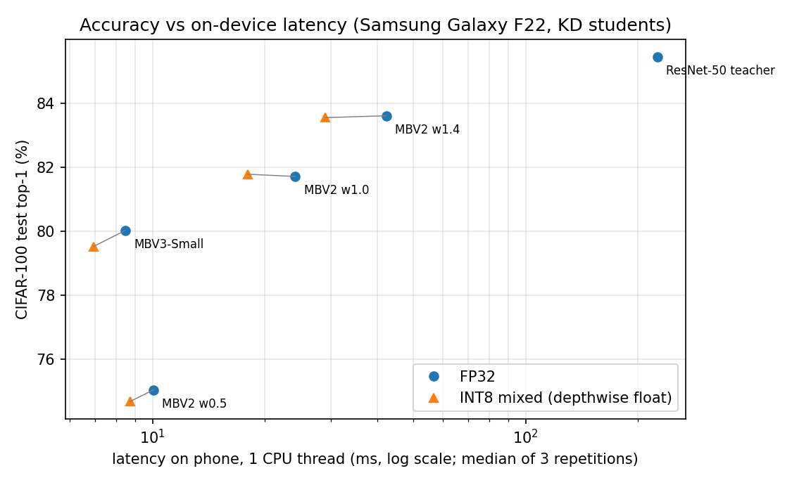
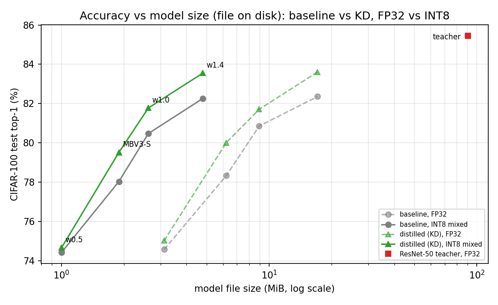

# Knowledge Distillation for On-Device Image Classification

**Project P25 — Section B, Team 25**

| Field | Details |
|---|---|
| **Team members** | Shivang Dubey (su-24137), Moirangthem Joel Singh (su-24080), Rajiv Kumar (su-24109), Prem Shankar Kushawaha (su-24100) |
| **Authorship note** | The implementation, experiments and this report were carried out by a single team member. |
| **Domain** | Image classification |
| **Datasets** | CIFAR-100 (main study), PlantVillage (secondary study) |
| **Code repository** | https://github.com/PSKprem/kd-ondevice-image-classification (private) |
| **Submission deadline** | 20 Nov 2026, 11:59 PM IST |

---

## Table of contents

1. [Abstract](#1-abstract)
2. [Introduction and objectives](#2-introduction-and-objectives)
3. [Background and related work](#3-background-and-related-work)
4. [Method](#4-method)
5. [Experimental setup](#5-experimental-setup)
6. [Experiments and results](#6-experiments-and-results)
7. [From model to phone: export, quantization and on-device measurement](#7-from-model-to-phone-export-quantization-and-on-device-measurement)
8. [Discussion — when does knowledge distillation help the most?](#8-discussion--when-does-knowledge-distillation-help-the-most)
9. [Limitations and threats to validity](#9-limitations-and-threats-to-validity)
10. [Conclusion](#10-conclusion)
11. [Reproducibility](#11-reproducibility)
12. [References](#12-references)

- [Appendix A — Full result tables](#appendix-a--full-result-tables)
- [Appendix B — Hyperparameters](#appendix-b--hyperparameters)
- [Appendix C — Project history and protocol changes](#appendix-c--project-history-and-protocol-changes)

---

## 1. Abstract

We study how well a large image classifier can be compressed into a small network that runs on a phone. A
ResNet-50 teacher (23.7 M parameters) is distilled (Hinton et al., 2015) into MobileNet students of four sizes
(0.82 M – 4.50 M parameters) on CIFAR-100, and the latency of the exported models is measured on a mid-range Android phone
(Samsung Galaxy F22). All model and hyper-parameter choices are made on a held-out validation split; the test set
is used only for reporting.

The main findings are:

1. **Distillation helps every student, but modestly when the student starts from good ImageNet weights.** Averaged
   over three seeds the test-accuracy gain is +0.46 pp (MobileNetV2 w0.5), +0.81 pp (w1.0), +1.70 pp (w1.4) and
   +1.53 pp (MobileNetV3-Small), and it is positive for every student and every seed. Inside the MobileNetV2 family the gain grows with
   width; a check with a single optimizer (AdamW) shows the same trend.
2. **Distillation helps much more when the student is weak or under-optimized.** Without ImageNet weights the gain is
   +2.50 pp (w0.5) and +5.60 pp (w1.0), 5–7× larger than with pretrained weights; a badly trained SGD baseline of
   w0.5 gained +6.25 pp.
3. **There is no consistent "KD helps most with little data" rule.** With 25 % of the data, w1.0 gains +2.03 pp
   (vs +0.85 pp with 100 %), but the tiny w0.5 gains nothing with little data (−0.22 pp at 10 %).
4. **On PlantVillage (≈99 % accuracy) no clear effect was found** (+0.05 and +0.31 pp, single seed).
5. **On the phone,** the best compromise student (MobileNetV2 w1.0, distilled, INT8) is **34× smaller** (2.6 vs
   90.4 MiB) and **12.5× faster** (18.0 vs 225.4 ms per image, one CPU thread) than the teacher, for a 3.7 pp loss in accuracy
   (81.78 % vs 85.46 %). Plain INT8 quantization failed for the smallest models; the cause was traced to their depthwise layers
   and fixed by keeping those layers in float32.

All claims are accompanied by their limitations (Section 9): most auxiliary experiments are single-seed, the optimizer is
confounded with model size in the main table, and only one phone was used.

---

## 2. Introduction and objectives

### 2.1 Problem statement

Large neural networks give the best accuracy but are too big and slow for phones. The task given in the project sheet is to
*compress a large teacher network into a tiny student that runs on a phone with minimal accuracy loss*.

### 2.2 Objectives

| # | Objective (from the project sheet) | Where addressed |
|---|---|---|
| O1 | Train a ResNet-50 teacher | §6.1 |
| O2 | Train a MobileNetV2 student normally (baseline, no KD) | §6.2 |
| O3 | Train the student with knowledge distillation and compare with the baseline | §6.3, §6.4 |
| O4 | Vary the temperature *T* and weight *α* | §6.3, §6.5 |
| O5 | Measure latency and model size (on a phone) | §7 — latency on the phone, file sizes; the accuracy of the exported models was additionally checked with the TFLite interpreter on a laptop (extra, see §9) |
| O6 (research angle) | Analyse the accuracy-vs-size Pareto curve: **when does KD help the most?** | §6.4, §6.6–6.9, §8 |

### 2.3 Contributions

* A reproducible, validation-based evaluation protocol for CIFAR-100 and an approximate leakage-reducing split for PlantVillage.
* A systematic comparison of baseline vs distilled students at four sizes with three seeds each.
* Controlled side experiments that separate the effect of model size from optimizer, initialization and data size.
* A complete export pipeline (PyTorch → ONNX → TFLite, FP32 and INT8) with accuracy verification on the full test set.
* A diagnosis of why INT8 quantization breaks the smallest MobileNets, and a mixed-precision fix.
* On-device latency measurements of every exported model on a real phone.

### 2.4 Compliance with the project sheet

The project sheet entry for P25 (mirrored in `project.md`) reads: *"Train ResNet-50 teacher → MobileNetV2 student trained normally vs with KD (vary temperature, alpha) → measure latency/size"*;
suggested dataset *"CIFAR-100 or PlantVillage"*; research angle *"Accuracy-vs-model-size Pareto curve; when does KD help most?"*. It was followed as follows.

| Requirement in the brief | Status | Note |
|---|---|---|
| ResNet-50 teacher | Done | §6.1 |
| MobileNetV2 student, baseline (no KD) | Done | §6.2; three widths (0.5 / 1.0 / 1.4) |
| MobileNetV2 student with KD, compared with the baseline | Done | §6.4, three seeds |
| Vary temperature T and α | Done | §6.3 (4 × 3 grid), §6.5 (α probe) |
| Datasets: CIFAR-100 *or* PlantVillage | Done for both | CIFAR-100 main, PlantVillage secondary (approximate split, §4.4) |
| Measure latency and model size (project sheet: *"measure latency/size"*) | Done | latency on the phone (§7.5), file sizes (§7.3), parameters (§4.2) |
| Extra (not required by the sheet): accuracy of the exported models | Done, on a laptop | every exported `.tflite` was evaluated on the full 10 000-image test set with the TFLite interpreter; the phone itself was used for latency (§9) |
| Accuracy-vs-model-size Pareto curve | Done | accuracy vs parameters (§6.4) and accuracy vs file size, FP32 and INT8 (§7.6) |
| Answer *when does KD help the most?* | Done | §6.4–6.8 and §8 |
| Reference papers (Hinton 2015, Sandler 2018) | Done | §3, §12 |
| Deliverables: report and GitHub repository | Report: this document; repository: yes (private) | §11 |

Additions beyond the brief: a second student architecture (MobileNetV3-Small), controls for optimizer, initialization and data size, the INT8 diagnosis, and the three-seed statistics.

---

## 3. Background and related work

**Knowledge distillation.** Hinton et al. (2015) train a small *student* to match the softened output distribution of a
large *teacher*. Dividing the logits by a temperature *T* > 1 reveals how the teacher ranks the wrong classes ("dark knowledge").
The student loss combines this soft-target term with the usual cross-entropy on the hard labels.

**MobileNets.** MobileNetV2 (Sandler et al., 2018) uses inverted residual blocks with linear bottlenecks and depthwise
separable convolutions; a *width multiplier* scales the number of channels and therefore the size of the network.
MobileNetV3-Small (Howard et al., 2019) adds squeeze-and-excitation blocks and the hard-swish activation and was found by architecture search.

**Teacher.** ResNet-50 (He et al., 2016), a 50-layer residual network.

**Quantization.** Storing weights (and possibly activations) as 8-bit integers makes the file about four times smaller and
can speed up inference (Jacob et al., 2018). Depthwise layers in MobileNets are known to be sensitive to quantization
(e.g. Nagel et al., 2019), which is relevant to Section 7.4.

---

## 4. Method

### 4.1 Distillation loss

For a mini-batch with student logits *z_s*, teacher logits *z_t* and labels *y*, the loss is (Hinton et al., 2015)

```
L = α · T² · KL( softmax(z_t / T)  ||  softmax(z_s / T) )  +  (1 − α) · CE( z_s, y )
```

implemented in `src/kd_loss.py` with `F.kl_div(log_softmax(z_s/T), softmax(z_t/T), reduction="batchmean")`. The factor T²
keeps the gradient of the soft term comparable to the hard term. The label-smoothing option of the cross-entropy is switched off (0) in all reported runs.
The teacher is frozen (`eval()` mode, no gradients) and sees exactly the same augmented image as the student.

### 4.2 Models

| Role | Model | Parameters (CIFAR-100 head) | Pretrained weights |
|---|---|---|---|
| Teacher | ResNet-50 | 23.71 M | torchvision `IMAGENET1K_V2` |
| Student | MobileNetV2, width 0.5 | 0.82 M | timm `mobilenetv2_050.lamb_in1k` |
| Student | MobileNetV3-Small | 1.62 M | torchvision `IMAGENET1K_V1` |
| Student | MobileNetV2, width 1.0 | 2.35 M | torchvision `IMAGENET1K_V2` |
| Student | MobileNetV2, width 1.4 | 4.50 M | timm `mobilenetv2_140.ra_in1k` |

All networks get a fresh classification head for the target dataset and are fine-tuned end-to-end. MobileNetV3-Small is an addition to the brief (which names MobileNetV2); it provides a second architecture for the size analysis. (A width-0.35 and a width-0.75
MobileNetV2 exist only without pretrained weights and were used only in early exploratory runs, see Appendix C.)

### 4.3 Training recipe

Identical for baseline and KD runs of the same student, so the only difference is the loss: 20 epochs, batch size 128,
cosine learning-rate schedule with one epoch of linear warm-up, mixed precision (fp16 autocast), input size 128×128,
ImageNet mean/standard-deviation normalization. Training augmentation: resize to 147 px, random 128-px crop, random horizontal flip.
Evaluation: resize to 147 px, centre crop 128 px. Two optimizer recipes were tried for every student (Section 6.2):
SGD (lr 0.01, momentum 0.9, weight decay 5e-4) and AdamW (lr 1e-3, weight decay 0.05).

### 4.4 Evaluation protocol (v2)

This protocol was adopted after an earlier version was found to be optimistic (Appendix C).

* **CIFAR-100.** The 50 000 training images are split once into **45 000 train / 5 000 validation** images, stratified (50
  validation images per class), with a fixed split seed (42) that is independent of the training seed. The 10 000 official test images are
  never used for any choice.
* **Selection on validation only.** The best epoch, the optimizer recipe of each student, and the common KD setting
  are chosen on the validation split. The test set is evaluated once per run, on the best-by-validation checkpoint
  (`test_top1`, the number reported in this document).
* **Noise level.** A validation set of 5 000 images has a standard error of about 0.55 pp for accuracies around 80 %, so
  differences of a few tenths of a point between single runs are not meaningful. For this reason all headline results (except the single teacher run) use three
  training seeds (42, 0, 1).
* **PlantVillage.** The dataset has no leaf identifier in the file names, so exact per-leaf grouping is impossible. Each class
  is cut into blocks of 20 consecutive image ids and whole blocks are assigned to train / validation / test (≈70 / 10 / 20 %). Neighbouring ids
  are measurably more similar than random images of the same class (mean absolute pixel difference 32.4 vs 39.0 on 24×24 thumbnails of 200 sampled pairs),
  so this reduces — but cannot remove — near-duplicate leakage (see §9).

### 4.5 Which numbers are "measured" and which are "derived"

All accuracies, latencies and file sizes in this report are read from the CSV files in `results/`. Percent gains are simple
differences of means in percentage points (pp). Speed-up factors are ratios of median latencies. Statements that explain *why* a result occurs are
labelled as hypotheses unless they were tested.

---

## 5. Experimental setup

### 5.1 Hardware and software

| Item | Value |
|---|---|
| Training machine | Laptop, NVIDIA GeForce RTX 4050 (6 GB), Intel Core i7-13620H, 16 GB RAM, Windows |
| Training software | Python 3.12.5, PyTorch 2.5.1 (CUDA 12.1), torchvision 0.20.1, timm 1.0.11 |
| Export software (separate environment) | ONNX 1.20.1, onnx2tf 2.6.9, TensorFlow 2.21.0, ai-edge-quantizer 0.10.0, ai-edge-litert 2.3.0 |
| Phone | Samsung Galaxy F22 (SM-E225F), Android 13, MediaTek Helio G80 (8 CPU cores), arm64-v8a |
| On-device tool | TensorFlow Lite `benchmark_model` (nightly build of 7 Feb 2025, SHA-256 `5D45116E…FABA1374`) with the XNNPACK CPU delegate |

### 5.2 Datasets

| Dataset | Images | Classes | Split used |
|---|---|---|---|
| CIFAR-100 (Krizhevsky, 2009) | 60 000 (32×32, upsampled to 128) | 100 | 45 000 train / 5 000 val / 10 000 test |
| PlantVillage (Hughes & Salathé, 2015; colour images, Kaggle copy) | 54 305 | 38 | 37 994 train / 5 425 val / 10 886 test (block split) |

### 5.3 Compute budget

All training was done on the single laptop GPU. The v2 study consists of **65 training runs** (48 CIFAR-100 runs including seeds, the alpha probe and the optimizer swap; 5 PlantVillage; 4 from scratch; 8
low-data), which took about **15 GPU-hours** in total (sum of the wall-clock times of the experiment queues; the teacher and the earlier v1 exploration are not included). A distilled run of the largest student (w1.4) takes
about 22–23 minutes, the PlantVillage teacher about 24 minutes. The phone benchmark of 78 measurements took 4.7 minutes.

---

## 6. Experiments and results

All accuracies are **top-1 test accuracy in %** of the best-by-validation checkpoint unless stated otherwise. "pp" = percentage points.

### 6.1 Teacher (O1)

| Model | Parameters | Optimizer | Best epoch | Val top-1 | **Test top-1** |
|---|---|---|---|---|---|
| ResNet-50 | 23.71 M | SGD, lr 0.01 | 14 | 86.06 | **85.46** |

### 6.2 Baseline students and choice of optimizer recipe (O2)

Each student was trained with both recipes (seed 42); the recipe with the higher **validation** accuracy was kept.

| Student | Params (M) | SGD val / test | AdamW val / test | Chosen (on val) |
|---|---|---|---|---|
| MobileNetV2 w0.5 | 0.82 | 61.26 / 60.63 | **74.90** / 74.58 | AdamW |
| MobileNetV3-Small | 1.62 | 77.92 / 78.20 | **78.32** / 78.34 | AdamW |
| MobileNetV2 w1.0 | 2.35 | **80.74** / 80.86 | 80.06 / 80.46 | SGD |
| MobileNetV2 w1.4 | 4.50 | **82.58** / 82.36 | 81.98 / 82.18 | SGD |

For w0.5, SGD with lr 0.01 is clearly under-trained (60.6 % vs 74.6 % with AdamW). This matters for interpreting the results in §6.7.

### 6.3 Temperature × α grid (O4)

Full grid on MobileNetV2 w1.0 (SGD recipe, seed 42), 12 distilled runs. Cells show **validation / test** accuracy; the baseline is 80.74 / 80.86.

| T \ α | α = 0.1 | α = 0.5 | α = 0.9 |
|---|---|---|---|
| T = 1 | 80.52 / 80.83 | 80.56 / 80.71 | 80.78 / 81.09 |
| T = 2 | 80.98 / 81.38 | 81.50 / 81.92 | 81.52 / 81.71 |
| T = 4 | 81.18 / 80.83 | 81.74 / 81.97 | **81.86** / 81.84 |
| T = 8 | 81.18 / 81.47 | 81.30 / 81.52 | 81.54 / 81.24 |



*Reading the grid.* All cells with T ≥ 2 and α ≥ 0.5 are between 81.2 and 82.0 on test; T = 1 is the weakest on validation (it provides little information beyond
the hard labels). The validation optimum is (T = 4, α = 0.9), but its lead over (T = 2, α = 0.9) is 0.34 pp, which is within the validation noise of ≈0.55 pp, and
validation and test pick different "best" cells. The whole grid spans only about 1.3 pp.

**Decision.** We therefore did **not** tune (T, α) per student. One common setting, **T = 2, α = 0.9**, is used for all students (it is within
noise of the validation optimum on w1.0, it did not harm w0.5 in earlier exploratory runs, and it gave gains for the larger students in those runs). The consequences of this choice
are examined in §6.5.

### 6.4 Main result: baseline vs KD at four sizes, three seeds (O3, O6)

Mean ± standard deviation over seeds 42 / 0 / 1; T = 2, α = 0.9.

| Student | Params (M) | Baseline | KD | **Gain (pp)** | Gain per seed (42 / 0 / 1) |
|---|---|---|---|---|---|
| MobileNetV2 w0.5 (AdamW) | 0.82 | 74.71 ± 0.16 | 75.17 ± 0.15 | **+0.46** | +0.45 / +0.44 / +0.49 |
| MobileNetV3-Small (AdamW) | 1.62 | 78.24 ± 0.26 | 79.77 ± 0.50 | **+1.53** | +1.68 / +2.15 / +0.76 |
| MobileNetV2 w1.0 (SGD) | 2.35 | 80.82 ± 0.07 | 81.63 ± 0.18 | **+0.81** | +0.85 / +0.89 / +0.68 |
| MobileNetV2 w1.4 (SGD) | 4.50 | 82.36 ± 0.02 | 84.06 ± 0.40 | **+1.70** | +1.25 / +2.02 / +1.84 |
| ResNet-50 teacher | 23.71 | 85.46 (1 seed) | — | — | — |





**Observations.**

* KD improves every student, and the paired gain is positive in all 12 (student, seed) pairs.
* Within MobileNetV2 the gain increases with width: +0.46 → +0.81 → +1.70 pp. The seed spread of the MobileNetV2 baselines (standard deviation ≤ 0.16 pp)
  is smaller than the differences between the gains of w0.5, w1.0 and w1.4.
* MobileNetV3-Small, a different architecture, shows a large but more variable gain (+0.76 to +2.15 pp).
* The distilled w1.4 student (84.06 %) is within 1.4 pp of the 23.7 M-parameter teacher with 5× fewer parameters;
  the distilled w1.0 student is 3.8 pp below it with 10× fewer.
* The student with the *largest gap to the teacher* (w0.5, 10.9 pp) has the *smallest* gain, so a large teacher–student gap alone does not predict a large gain.

### 6.5 Sensitivity to α (O4)

Gain over the baseline on test (pp), T = 2, one seed (seed 42):

| Student | α = 0.1 | α = 0.5 | α = 0.9 (used) |
|---|---|---|---|
| MobileNetV2 w0.5 | +0.32 | +0.40 | +0.45 |
| MobileNetV2 w1.0 | +0.52 | +1.06 | +0.85 |
| MobileNetV2 w1.4 | +0.28 | +1.53 | +1.25 |



A small weight on the soft term (α = 0.1) is clearly the weakest for the larger students. α = 0.5 is slightly better than the α = 0.9 used in the main
experiments for w1.0 and w1.4 (validation agrees for w1.4: +1.04 vs +1.00), but the 0.2–0.3 pp difference is within noise. Because the common
setting was fixed before this probe, it was kept; the probe is reported only to show that the main results are not an artefact of an unusually bad α. The main
gains might therefore be slightly under-estimated for the larger students.

### 6.6 Separating model size from optimizer (O6)

In the main table the smaller students use AdamW and the larger ones SGD (each chosen on validation), so size and optimizer are mixed. To separate them,
every student was also distilled with the *other* recipe (seed 42; the 8 baselines already existed).

| Student | SGD: baseline → KD (gain) | AdamW: baseline → KD (gain) |
|---|---|---|
| MobileNetV2 w0.5 | 60.63 → 66.88 (**+6.25**) | 74.58 → 75.03 (+0.45) |
| MobileNetV3-Small | 78.20 → 79.84 (+1.64) | 78.34 → 80.02 (+1.68) |
| MobileNetV2 w1.0 | 80.86 → 81.71 (+0.85) | 80.46 → 81.53 (+1.07) |
| MobileNetV2 w1.4 | 82.36 → 83.61 (+1.25) | 82.18 → 84.05 (+1.87) |



* **With AdamW alone** the gain rises with width, +0.45 → +1.07 → +1.87 pp, so the width trend is not only an optimizer artefact.
* **With SGD** the trend holds from w1.0 to w1.4, but w0.5 is a large outlier (+6.25 pp). Its SGD baseline is badly under-trained (60.63 %), so the
  teacher's soft labels help it a lot — the same pattern as in §6.7.
* MobileNetV3-Small gains about the same under both optimizers.
* These swapped-recipe runs are single-seed.

### 6.7 Pretrained vs from scratch (O6)

The same students were trained **without** ImageNet weights (random initialization), 20 epochs, same recipe and teacher (single seed).

| Student | Initialization | Baseline | KD | Gain (pp) |
|---|---|---|---|---|
| MobileNetV2 w0.5 | pretrained (3 seeds) | 74.71 | 75.17 | +0.46 |
| MobileNetV2 w0.5 | **from scratch** | 47.44 | 49.94 | **+2.50** |
| MobileNetV2 w1.0 | pretrained (3 seeds) | 80.82 | 81.63 | +0.81 |
| MobileNetV2 w1.0 | **from scratch** | 57.33 | 62.93 | **+5.60** |



Without pretrained weights distillation helps 5–7× more (validation agrees: +3.64 and +5.56 pp). The effect is far larger than the seed spread (≈0.2 pp).
Caveat: 20 epochs are not enough for random-initialized networks to converge (47 % and 57 %), so part of the gain may be *faster learning* from the teacher's
soft labels rather than a better final model.

### 6.8 Amount of training data (O6)

Students trained on a stratified, nested subset of the 45 000 training images (the teacher was trained on all of them), 20 epochs, single seed.

| Student | Training data | Baseline | KD | Gain (pp) |
|---|---|---|---|---|
| MobileNetV2 w1.0 (SGD) | 10 % (4 500 images) | 65.81 | 66.93 | +1.12 |
| MobileNetV2 w1.0 (SGD) | 25 % (11 200) | 72.72 | 74.75 | **+2.03** |
| MobileNetV2 w1.0 (SGD) | 100 % (45 000) | 80.86 | 81.71 | +0.85 |
| MobileNetV2 w0.5 (AdamW) | 10 % | 56.44 | 56.22 | −0.22 |
| MobileNetV2 w0.5 (AdamW) | 25 % | 64.87 | 64.97 | +0.10 |
| MobileNetV2 w0.5 (AdamW) | 100 % | 74.58 | 75.03 | +0.45 |



The result is mixed. For w1.0 KD helps more with less data (+2.03 pp at 25 % vs +0.85 pp at 100 %), though not monotonically (10 % is lower). For the tiny w0.5 the
opposite holds: KD does not help when data is scarce. A general rule "KD helps most with little data" is therefore **not** supported, and the two
students also differ in optimizer.

### 6.9 PlantVillage (second dataset)

Teacher and the two students w0.5 and w1.0, with the same recipes and the same KD setting as for CIFAR-100 (not re-tuned), single seed, block split.

| Model | Parameters (M) | Baseline | KD (T = 2, α = 0.9) | Gain (pp) |
|---|---|---|---|---|
| ResNet-50 (teacher) | 23.59 | 99.05 | — | — |
| MobileNetV2 w0.5 | 0.74 | 98.72 | 98.77 | +0.05 |
| MobileNetV2 w1.0 | 2.27 | 98.96 | 99.27 | +0.31 |

PlantVillage is nearly saturated: the test set has 10 886 images, so +0.05 pp is about 5 images and +0.31 pp about 34 images, and the standard error of an accuracy near
99 % is already ≈0.1 pp. The distilled w1.0 student (99.27 %) even exceeds its teacher (99.05 %). This, together with the approximate block split (possible near-duplicate leakage),
indicates that **PlantVillage cannot separate the models well**; we draw no conclusion about KD from it other than "no clear effect".

---

## 7. From model to phone: export, quantization and on-device measurement

### 7.1 Export pipeline (O5)

```
PyTorch checkpoint ──► ONNX ──► TFLite FP32 ──► INT8 variants
(best-by-val .pt)     (torch.onnx)  (onnx2tf -b 1)   (ai-edge-quantizer)
```

For each student the distilled checkpoint (the model that would be shipped) and the baseline checkpoint were exported, plus the FP32 teacher. Two attempts that did
not work are documented in `requirements-export.txt`: the older `onnx-tf` converter (unmaintained), and onnx2tf's own quantized outputs / TensorFlow-converter backend
(broken accuracy or a layout error on MobileNetV2). The final route converts to a float32 `.tflite` with onnx2tf and quantizes that file with Google's ai-edge-quantizer.

**Correctness of the export.** The FP32 TFLite models give exactly the same predictions as the PyTorch models (100 % agreement on every distilled student, checked on 2 000 test images, and on the teacher, checked on 300 images).

### 7.2 Quantization variants

| Variant | Weights | Activations | Notes |
|---|---|---|---|
| FP32 | float32 | float32 | reference |
| INT8 dynamic | int8, per channel | int8 computed at run time | smallest, but see below |
| INT8 mixed (final) | int8 (per channel) for regular convolutions and the classifier; **depthwise convolutions kept float32** | as dynamic | fixes the accuracy problem |

### 7.3 Accuracy of the exported models (full 10 000-image test set)

KD checkpoint / baseline checkpoint. File sizes in MiB.

| Student | FP32 file | PyTorch FP32 | INT8 dynamic file | INT8 dynamic | INT8 mixed file | **INT8 mixed** |
|---|---|---|---|---|---|---|
| MobileNetV2 w0.5 | 3.12 | 75.03 / 74.58 | 0.94 | 71.63 / 71.75 | 1.00 | **74.67 / 74.43** |
| MobileNetV3-Small | 6.22 | 80.02 / 78.34 | 1.75 | **13.14 / 9.76** | 1.89 | **79.52 / 78.04** |
| MobileNetV2 w1.0 | 8.95 | 81.71 / 80.86 | 2.52 | 81.78 / 80.59 | 2.62 | 81.78 / 80.48 |
| MobileNetV2 w1.4 | 17.10 | 83.61 / 82.36 | 4.65 | 83.23 / 81.97 | 4.79 | 83.55 / 82.26 |
| ResNet-50 teacher | 90.39 | 85.46 | — | — | — | — |

The advantage of distillation survives quantization: after INT8-mixed export the distilled models are better than their baselines by +0.24 (w0.5), +1.48 (MobileNetV3-Small),
+1.30 (w1.0) and +1.29 pp (w1.4).

### 7.4 Why plain INT8 broke the smallest models, and the fix

Plain dynamic INT8 gave excellent results for w1.0 and w1.4, lost 3.4 pp on w0.5, and destroyed MobileNetV3-Small (13 % accuracy). An early hypothesis (per-tensor weight
quantization) was **wrong**: the quantizer already uses per-channel weights, and inspecting the produced files confirmed that all convolution weights, including depthwise ones, are per-channel.
A diagnosis in pure PyTorch (`scripts/diag_quant.py`) then showed:

1. **The conversion is correct.** Fake-quantizing the weights to per-channel int8 *in PyTorch* reproduces the TFLite weight-only accuracy exactly (w0.5: 72.85 % on both; MobileNetV3-Small: 79.65 % on both).
2. **BatchNorm folding is not the cause** — per-channel quantization is invariant to the per-channel BN scale.
3. **For w0.5 the damage comes from the depthwise layers.** Accuracy change on 2 000 test images when only one group of layers is quantized to int8 (pp):

| Student | first conv | depthwise | pointwise (1×1) | classifier | all layers | FP32 (2 000 imgs) |
|---|---|---|---|---|---|---|
| MobileNetV2 w0.5 | −0.05 | **−2.60** | −0.55 | +0.05 | 72.85 | 75.75 |
| MobileNetV2 w1.0 | +0.10 | −0.05 | +0.20 | 0.00 | 81.75 | 81.55 |
| MobileNetV2 w1.4 | +0.15 | −0.45 | −0.05 | +0.05 | 83.05 | 83.40 |
| MobileNetV3-Small | −0.15 | −0.50 | −0.50 | 0.00 | 79.65 | 80.30 |

4. **For MobileNetV3-Small the weights are fine** (79.65 % with weight-only int8); only run-time (dynamic) quantization of activations breaks it.

**Fix.** Keep the depthwise convolutions in float32 and quantize everything else ("mixed"). This restores accuracy (w0.5: 74.67 %, −0.36 pp vs PyTorch FP32; MobileNetV3-Small: 79.52 %, −0.50 pp)
at essentially the same file size. *Why* w0.5's depthwise weights are so sensitive is **not established** (a plausible, untested explanation is that this small network has little redundancy
in those layers).

### 7.5 On-device latency (O5)

Setup: TFLite `benchmark_model`, CPU with the XNNPACK delegate, 10 warm-up and 100 timed inferences, **median of 3 repetitions**, 1 and 4 threads, models executed through `adb`
from `/data/local/tmp` (nothing was installed on the phone; the folder was deleted afterwards). The battery temperature stayed between 32.8 and 33.1 °C during all 78 measurements, so
thermal throttling is unlikely. Input size 128×128, batch 1.

Latency in milliseconds per image (distilled models):

| Model | 1 thread: FP32 | dynamic | **mixed** | 4 threads: FP32 | dynamic | **mixed** |
|---|---|---|---|---|---|---|
| MobileNetV2 w0.5 | 10.05 | 9.10 | **8.71** | 7.88 | 11.89 | **7.68** |
| MobileNetV3-Small | 8.45 | 6.99 | **6.95** | 10.69 | 10.14 | **8.71** |
| MobileNetV2 w1.0 | 24.11 | 18.35 | **17.98** | 13.87 | 17.18 | **12.06** |
| MobileNetV2 w1.4 | 42.30 | 29.52 | **28.99** | 21.00 | 23.75 | **16.79** |
| ResNet-50 teacher | 225.35 | — | — | 90.33 | — | — |



**Observations.**

* INT8-mixed is the fastest variant for every student: 13 % (w0.5) to 32 % (w1.4) faster than FP32 on one thread, and also fastest on four threads.
* Plain dynamic INT8 is *slower* than FP32 on four threads for w0.5, w1.0 and w1.4, so the mixed recipe is better in speed as well as in accuracy.
* The two small models do not profit from extra threads (MobileNetV3-Small is even slower on four threads); only the larger models scale.
* Memory footprint increase reported by `benchmark_model` (FP32, 1 thread): 17 MB (w0.5), 20 MB (MobileNetV3-Small), 36 MB (w1.0), 59 MB (w1.4), 196 MB (teacher).

### 7.6 The headline trade-off

| | Teacher ResNet-50 (FP32) | Student MobileNetV2 w1.0, distilled, INT8-mixed | Ratio |
|---|---|---|---|
| File size | 90.39 MiB | 2.62 MiB | **34× smaller** |
| Latency on the phone (1 thread) | 225.4 ms | 18.0 ms | **12.5× faster** |
| Test accuracy | 85.46 % | 81.78 % | −3.68 pp |
| Parameters | 23.71 M | 2.35 M | 10× fewer |



The accuracy-vs-size curve in terms of file size (seed-42 models, test set, full 10 000 images for INT8): at every size the distilled model is above its baseline, in FP32 and after INT8 export, and the INT8-mixed
distilled models move the whole curve to the left (files 3.1–3.6× smaller) at almost unchanged accuracy.

If the accuracy requirement is stricter, the distilled w1.4 student (INT8-mixed) reaches 83.55 % (−1.9 pp vs the teacher) at 4.79 MiB and 29.0 ms (19× smaller, 7.8× faster). If the latency
budget is tighter, the distilled MobileNetV3-Small (INT8-mixed) offers 79.52 % at 6.95 ms.

---

## 8. Discussion — when does knowledge distillation help the most?

The project's research question was *when KD helps the most*. Putting the experiments together:

1. **KD helps most when the student starts from a weak position.** The largest gains are for students without ImageNet weights (+2.5 and +5.6 pp), for a badly optimized baseline (+6.25 pp for w0.5 with SGD) and, to a lesser degree, for
   all small data regimes of w1.0 (+1.1 to +2.0 pp). For well-initialized, well-tuned students the gain is small (+0.5 to +1.7 pp). Interpretation (a hypothesis, not tested): the teacher's soft labels supply
   information that a weak student cannot obtain from the hard labels alone, whereas a well-pretrained student already has most of it.
2. **Among well-tuned pretrained students, the gain grows with capacity.** +0.46, +0.81 and +1.70 pp for MobileNetV2 w0.5, w1.0, w1.4 (three seeds), and +0.45, +1.07, +1.87 pp with AdamW alone (one seed). A possible explanation is that a larger student has
   more capacity to absorb the teacher's knowledge, but we did not test this. The teacher–student accuracy *gap* does not explain it (the smallest student has the largest gap and the smallest gain).
3. **The architecture matters.** MobileNetV3-Small gains +1.53 pp despite having only 1.6 M parameters, more than MobileNetV2 w1.0 (2.35 M).
4. **Distillation is not a universal benefit.** On PlantVillage (≈99 %) there is no clear effect, and the tiny w0.5 student gains nothing in the low-data setting. A saturated dataset, or a student that cannot absorb more, leaves little to gain.
5. **The benefit is retained after compression.** The distilled models stay about 1.3 pp ahead of their baselines after INT8 export (w1.0, w1.4).
6. **For deployment,** compression matters more than distillation: the big wins on the phone (34× smaller, 12.5× faster) come from replacing the teacher with a MobileNet and from INT8, while distillation adds 0.5–1.7 pp of accuracy at no inference cost.

Practical guidance derived from these results: (i) always train the baseline well first — an under-trained baseline inflates the apparent benefit of KD; (ii) distillation is most valuable when pretrained weights or large amounts of data are
unavailable; (iii) for MobileNets check depthwise layers before quantizing.

---

## 9. Limitations and threats to validity

**Statistics**
* Main results use three seeds; the optimizer swap (§6.6), alpha probe (§6.5), from-scratch (§6.7), low-data (§6.8) and PlantVillage (§6.9) experiments are **single-seed**. With three seeds the standard-deviation estimates are crude.
* Validation noise (≈0.55 pp) is larger than many of the differences between neighbouring (T, α) cells, so the grid should not be read as a precise optimum.

**Design**
* Optimizer is confounded with model size in the main table (§6.6 partly addresses this; w0.5 under SGD is a special case).
* A single common (T, α) = (2, 0.9) was used for all students; α = 0.5 was slightly better for the larger students (within noise). Temperature was not re-tuned per student.
* The teacher was trained once (one seed) on all training data, also in the low-data study.
* From-scratch runs are not converged after 20 epochs.
* The recipe for PlantVillage was not re-tuned.

**Data**
* PlantVillage has no leaf identifier; the block split reduces but does not eliminate near-duplicate leakage, and the dataset is saturated.
* CIFAR-100 images are upsampled from 32×32 to 128×128.

**Deployment**
* One phone (mid-range, MediaTek Helio G80), CPU only (no GPU/NNAPI delegate). Latency was measured with the native `benchmark_model` binary outside an Android app, which can differ slightly from in-app performance.
* The XNNPACK delegate accepted only 80 of 120 graph nodes for the w1.0 model (the cause was not investigated), so the converted graphs may not be optimal.
* The cause of the depthwise sensitivity of w0.5 is not established.
* The teacher was not quantized, and the accuracy of INT8 models was evaluated with the TFLite interpreter on a laptop, not on the phone.

**Process**
* An earlier protocol selected the best epoch on the test set; all such results were discarded as headline numbers (Appendix C).

---

## 10. Conclusion

A ResNet-50 teacher was distilled into MobileNet students of four sizes and the result was deployed and measured on a phone. Distillation consistently improved the students (+0.46 to +1.70 pp
for pretrained MobileNetV2 widths, +1.53 pp for MobileNetV3-Small, positive in all 12 seed pairs), with the largest effects when the student lacks good initialization or optimization (+2.5 to +6.3 pp).
The practical outcome is a distilled MobileNetV2 w1.0 that is 34× smaller and 12.5× faster than the teacher on a mid-range Android phone for a loss of 3.7 pp in accuracy, and a
distilled w1.4 that is within 1.9 pp of the teacher at 19× smaller size. The study also produced a methodological lesson: validation-based selection, multiple seeds and controls (optimizer, initialization, data size) change
conclusions that a single run would suggest, and INT8 quantization of small MobileNets must be checked layer by layer.

---

## 11. Reproducibility

| Item | Location |
|---|---|
| Code | `src/` (data, models, KD loss, training, evaluation) and `scripts/` (experiment queues, plotting, export, benchmarking) |
| Configs | `configs/teacher.yaml`, `student.yaml`, `kd.yaml` |
| All raw results | `results/*.csv` (`results_v2.csv`, `results_pv_v2.csv`, `results_scratch_v2.csv`, `results_lowdata_v2.csv`, `export_eval_v2.csv`, `phone_latency_v2.csv`) |
| Summary tables | `results/kd_gain_v2.csv`, `summary_table_v2.csv`, `recipe_swap_v2.csv`, `alpha_probe_v2.csv`, `summary_*_v2.csv` |
| Figures | `results/figures/` (generated by `scripts/plot_results.py` and `scripts/plot_report_figures.py`) |
| Environments | `requirements.txt` (training), `requirements-export.txt` (export, versions verified), Kaggle CLI in a separate environment |
| Detailed instructions and live status | `README.md`, `task.md` |

Checkpoints, exported `.tflite` files and datasets are not stored in git (size); they are kept on the author's disk.
Main commands (see `README.md` for all of them):

```
python -m src.train --config configs/teacher.yaml
python -m src.train --config configs/student.yaml --width-mult 0.5
python -m src.train --config configs/kd.yaml --teacher-ckpt <teacher best.pt> --width-mult 0.5
scripts\queue_v2_night1.ps1    # teacher, 8 baselines, T x alpha grid
scripts\queue_v2_exp4.ps1      # KD on all students (+ alpha probe);  scripts\queue_v2_seeds.ps1 for seeds
python scripts\export_all.py   # export + accuracy check (export environment)
python scripts\phone_benchmark.py --adb <path to adb>
```

---

## 12. References

1. G. Hinton, O. Vinyals, J. Dean. *Distilling the Knowledge in a Neural Network.* arXiv:1503.02531, 2015.
2. M. Sandler, A. Howard, M. Zhu, A. Zhmoginov, L.-C. Chen. *MobileNetV2: Inverted Residuals and Linear Bottlenecks.* CVPR 2018. arXiv:1801.04381.
3. A. Howard et al. *Searching for MobileNetV3.* ICCV 2019. arXiv:1905.02244.
4. K. He, X. Zhang, S. Ren, J. Sun. *Deep Residual Learning for Image Recognition.* CVPR 2016. arXiv:1512.03385.
5. A. Krizhevsky. *Learning Multiple Layers of Features from Tiny Images.* Technical report, 2009.
6. D. P. Hughes, M. Salathé. *An open access repository of images on plant health to enable the development of mobile disease diagnostics.* arXiv:1511.08060, 2015.
7. B. Jacob et al. *Quantization and Training of Neural Networks for Efficient Integer-Arithmetic-Only Inference.* CVPR 2018. arXiv:1712.05877.
8. M. Nagel, M. van Baalen, T. Blankevoort, M. Welling. *Data-Free Quantization Through Weight Equalization and Bias Correction.* ICCV 2019. arXiv:1906.04721.
9. I. Loshchilov, F. Hutter. *Decoupled Weight Decay Regularization.* ICLR 2019. arXiv:1711.05101.
10. R. Wightman. *PyTorch Image Models (timm).* https://github.com/huggingface/pytorch-image-models.
11. TensorFlow Lite / LiteRT documentation: *Performance measurement* (`benchmark_model`), https://www.tensorflow.org/lite/performance/measurement.

---

## Appendix A — Full result tables

### A.1 All CIFAR-100 runs of the 3-seed study (test top-1)

| Student | Run | Seed 42 | Seed 0 | Seed 1 |
|---|---|---|---|---|
| w0.5 | baseline | 74.58 | 74.89 | 74.65 |
| w0.5 | KD | 75.03 | 75.33 | 75.14 |
| w1.0 | baseline | 80.86 | 80.86 | 80.74 |
| w1.0 | KD | 81.71 | 81.75 | 81.42 |

(The per-seed values of w1.4 and MobileNetV3-Small are in `results/results_v2.csv`; gains per seed are in §6.4. The seed-1 distilled MobileNetV3-Small run reached 79.19 % and the seed-1 distilled w1.0 run 81.42 %.)

### A.2 Exported-model agreement with PyTorch

| Model | FP32 TFLite (2 000 images) | INT8 mixed (10 000 images) |
|---|---|---|
| w0.5 KD | 100.00 % | 95.82 % |
| MobileNetV3-Small KD | 100.00 % | 96.47 % |
| w1.0 KD | 100.00 % | 97.67 % |
| w1.4 KD | 100.00 % | 98.41 % |

(Agreement = fraction of test images for which the TFLite model predicts the same class as the PyTorch model.)

### A.3 Memory footprint increase reported by the benchmark tool (MB, FP32, 1 thread)

17.2 (w0.5), 20.3 (MobileNetV3-Small), 35.6 (w1.0), 58.6 (w1.4), 196.1 (teacher).

---

## Appendix B — Hyperparameters

| Setting | Value |
|---|---|
| Epochs | 20 (all runs, including low-data and from-scratch) |
| Batch size | 128 |
| LR schedule | cosine, 1 warm-up epoch (per-step), mixed precision |
| SGD recipe | lr 0.01, momentum 0.9, weight decay 5e-4 |
| AdamW recipe | lr 1e-3, weight decay 0.05 |
| Label smoothing | 0 |
| KD (main) | T = 2, α = 0.9 |
| KD (grid) | T ∈ {1, 2, 4, 8} × α ∈ {0.1, 0.5, 0.9} on MobileNetV2 w1.0 |
| Image size | 128 × 128 (train: resize 147 → random crop, flip; test: resize 147 → centre crop) |
| Seeds | 42 (all experiments), 0 and 1 (3-seed study) |
| Split seed | 42 (fixed, independent of the training seed) |
| PlantVillage split | blocks of 20 consecutive ids per class; 10 % val, 20 % test |
| Quantization | ai-edge-quantizer recipes: dynamic int8 (per-channel), weight-only int8, static int8 (tried), mixed (convolutions and fully-connected int8, depthwise float32) |
| Phone benchmark | 10 warm-up + 100 timed runs, 1 and 4 threads, 3 repetitions (median), XNNPACK |

---

## Appendix C — Project history and protocol changes

This appendix records how the work evolved, because several early results were later replaced.

1. **Setup and first runs.** A first set of experiments (called "v1" in the repository) trained the teacher, baselines, a T × α sweep on w0.5 and a final comparison of all widths.
   These runs selected the best epoch on the **test** set, which makes the numbers optimistic, and used SGD with label smoothing 0.1.
2. **Observed problem.** In that recipe, high T and α made the w0.5 student collapse (accuracy fell from 60.8 % to 31.1 % at T = 4, α = 0.9). The w0.5 baseline of that recipe was itself under-trained;
   with the AdamW recipe and no label smoothing there was no collapse (two settings changed together, so we cannot say which one mattered). The v1 results are kept in `results/results.csv` only as history.
3. **Protocol v2.** The evaluation protocol was rebuilt (45 000 / 5 000 / 10 000 split, selection on validation only, test reported once) and every experiment in this report was re-run under it. The common KD setting
   T = 2, α = 0.9 was adopted instead of the validation optimum of the w1.0 grid (T = 4, α = 0.9), because the earlier w0.5 data showed that high-T / high-α settings can hurt small students and because the grid
   differences are within noise.
4. **Additions.** Three seeds for all students, an α probe, a swapped-optimizer control, a from-scratch comparison, a low-data study, the PlantVillage study, the export pipeline, the INT8 diagnosis and the phone benchmark were added in that order.
5. **Wrong turns that were corrected.** (a) The claim "gain depends only on size" was withdrawn because size, optimizer and architecture were mixed (§6.6). (b) The hypothesis that per-tensor weight quantization caused the INT8 failures was tested and rejected (§7.4).
   (c) An early impression that distillation does nothing for w0.5 (from the v1 single-protocol runs) was replaced by the 3-seed result of a small but consistent +0.46 pp.
6. **Work organisation.** The project was implemented by one team member; the repository history documents the sequence above.
